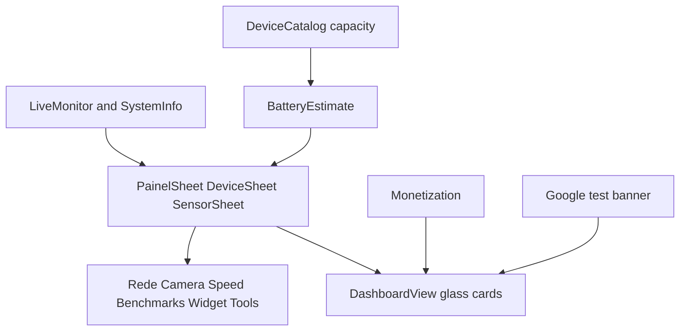

# Sonda Design

**Spec**: `.specs/features/sonda/spec.md`
**Status**: Draft

---

## Architecture Overview

Sonda stays the SwiftUI app that already ships the glass painel, the device screen, and the sensors screen. New figures are computed in pure Swift types. The views render those types and do not keep a second copy of a formula or a spec string.

Two approaches were considered. A parallel monitor module would duplicate `LiveMonitor` and the glass cards. Copying CPU-x is forbidden by the spec. The chosen approach extends the current targets: one pure type per rule, the existing views bound to those types, XCTest over the types.



The rules that change a number or a sentence live in the pure types. `SondaTests` imports those types. A view task only binds the type.

Battery watts, volts, and current stay estimates (AD-005). The strings use a fixed decimal point so the tests do not depend on the simulator locale: `2.2 W estimativa`, `3.87 V estimativa`, `568 mA estimativa`.

Watts are rounded to one decimal with `Decimal`, half away from zero. Current is the integer nearest to `watts / 3.87 × 1000`, using Swift `rounded()` (ties away from zero).

Pinned results:

| State | CPU fraction | Watts | Current |
| --- | --- | --- | --- |
| Unplugged | 0.25 | 2.2 W | 568 mA |
| Unplugged | 0 | 1.2 W | 310 mA |
| Charging | any | 12.0 W | 3101 mA |
| Full | any | 0.5 W | 129 mA |
| Unknown, or monitoring off | any | no formula | no formula |

Monitoring off shows charge as `—`. Unknown state and monitoring off show `Indisponível` for watts, volts, and current. A known model still shows catalog capacity. An unknown model identifier shows `Indisponível` for capacity and the three estimates, and no watt number.

---

## Code Reuse Analysis

### Existing Components to Leverage

| Component | Location | How to Use |
| --- | --- | --- |
| Live sample loop | `Sonda/Sonda/Monitoring/LiveMonitor.swift` | Keep the 1 second loop. Map `UIDevice.BatteryState` into `BatteryPowerState` before calling `BatteryEstimate`. |
| Device catalog | `Sonda/Sonda/Monitoring/DeviceCatalog.swift` | Add `capacityMilliampHours`. Do not read `Battery.plist`. |
| Glass painel | `Sonda/Sonda/Views/DashboardView.swift` | Keep `MetricCard`, glass core buttons, and history charts. Bind the new rows to `PainelSheet`. |
| Device and sensors screens | `Sonda/Sonda/Views/DeviceView.swift`, `SensorsView.swift` | Keep the sections. Bind them to `DeviceSheet` and `SensorSheet`. |
| Formatters | `Sonda/Sonda/Views/Formatting.swift` | Keep byte, thermal, and battery-state words. Estimate rows use the fixed strings from `BatteryEstimate`, not `Format`. |
| Interface counters | `Sonda/Sonda/Monitoring/NetworkSampler.swift` | Session totals call `SessionTraffic`. Only `en*` and `pdp_ip*` count. `lo0` and other names are ignored. |

### Integration Points

| System | Integration Method |
| --- | --- |
| UIDevice battery | Level and state only. `isBatteryMonitoringEnabled` stays in `LiveMonitor.start`. |
| Google Mobile Ads | Swift package `https://github.com/googleads/swift-package-manager-google-mobile-ads`. The task pins the stable major that resolves at implementation. Test app id `ca-app-pub-3940256099942544~1458002511`. Test banner `ca-app-pub-3940256099942544/2934735716`. Never the CPU-x publisher id. |
| WidgetKit | New extension target. The app writes `WidgetSnapshot` into the app group `group.com.azvdo.sonda`. |
| Picture in Picture | A locally generated sample buffer. No file from `CPU-x.ipa`. |
| XCTest | New `SondaTests` target, host app `Sonda`, `@testable import Sonda`. |

---

## Components

### BatteryEstimate

- **Purpose**: Turns CPU fraction, battery state, monitoring flag, and optional capacity into the battery rows.
- **Location**: `Sonda/Sonda/Monitoring/BatteryEstimate.swift`
- **Interfaces**:
  - `BatteryPowerState` - `unplugged`, `charging`, `full`, `unknown`
  - `BatteryEstimate.make(cpuUsage:state:monitoringEnabled:capacityMilliampHours:) -> BatteryEstimate`
  - Rows: `capacityText`, `wattsText`, `voltsText`, `currentText`, `chargeText`
- **Dependencies**: Foundation only
- **Reuses**: None. `LiveMonitor` maps UIKit state in the view-model task that already owns the loop, inside `PainelSheet.make`.

### DeviceCatalog capacity

- **Purpose**: Stores nominal mAh on each existing `DeviceSpec`.
- **Location**: `Sonda/Sonda/Monitoring/DeviceCatalog.swift`
- **Interfaces**:
  - `DeviceSpec.capacityMilliampHours: Int`
  - `DeviceCatalog.spec(for:) -> DeviceSpec?` unchanged
- **Dependencies**: None
- **Reuses**: The identifier table already in the file

### PainelSheet

- **Purpose**: Builds the painel sections, core rows, pause labels, and the foreground sample gate.
- **Location**: `Sonda/Sonda/Monitoring/PainelSheet.swift`
- **Interfaces**:
  - `PainelSheet.make(...) -> PainelSheet` with sections Processador, Memória, Rede, Bateria, Térmico, Armazenamento
  - `CoreSelection.toggle(current:tapped:) -> Int?`
  - `MonitorToggle.title(isRunning:) -> String` returns `Pausar` or `Retomar`
  - `MonitorToggle.isRunning(afterTapWhileRunning:) -> Bool`
  - `SampleGate.runs(active:) -> Bool`
- **Dependencies**: `BatteryEstimate`, `DeviceCatalog`
- **Reuses**: `MemorySnapshot`, `StorageSnapshot`, `Format` for non-estimate percents

Empty `cpuCores` yields cpu text `0%` and no core rows. A nil Wi-Fi address yields `Sem conexão`. The frequency caption is `frequência estimada`.

### Monetization

- **Purpose**: One banner region, the failure sentence, and an empty purchase list.
- **Location**: `Sonda/Sonda/Monitoring/Monetization.swift`
- **Interfaces**:
  - `BannerPresentation.make(loadFailed:) -> BannerPresentation` with `regionVisible == true`
  - Failed load sets `message` to `Anúncio indisponível`
  - `Monetization.productIdentifiers: [String]` stays `[]`
  - `Monetization.purchaseControls(offersPurchase:) -> [String]`
- **Dependencies**: None
- **Reuses**: None

### DashboardView

- **Purpose**: Renders every `PainelSheet` section inside the existing glass cards, the core buttons, and one banner region.
- **Location**: `Sonda/Sonda/Views/DashboardView.swift`
- **Interfaces**: Existing `DashboardView(monitor:system:)`. Body reads `PainelSheet` and `BannerPresentation`.
- **Dependencies**: `PainelSheet`, `Monetization`, Google Mobile Ads
- **Reuses**: `MetricCard`, `CoreGlassButton`, `HistoryChart`, `GlassBackdrop`

The view contains no watt formula. Charts stay on `LiveMonitor` history.

### DeviceSheet and SensorSheet

- **Purpose**: The dispositivo and sensores rows, including absence copy.
- **Location**: `Sonda/Sonda/Monitoring/DeviceSheet.swift`, `Sonda/Sonda/Monitoring/SensorSheet.swift`
- **Interfaces**:
  - `DeviceSheet.make(system:) -> [SheetSection]`
  - Missing catalog chip name is `Desconhecido`. Process and max clock appear only when `spec` is non-nil. Cache rows appear only when the integers exist. Missing GPU is the row `Metal indisponível`.
  - `SensorSheet.make(...) -> [SheetSection]`
  - A missing sensor section contains `Indisponível neste aparelho`. Present axes show X, Y, Z.
- **Dependencies**: `SystemInfo`, `Vector3`
- **Reuses**: `DeviceView` and `SensorsView` section titles

### SessionTraffic

- **Purpose**: Session byte totals and the SSID sentence.
- **Location**: `Sonda/Sonda/Monitoring/NetworkSampler.swift`
- **Interfaces**:
  - `SessionTraffic.add(name:received:sent:into:)` counts `en*` as Wi-Fi and `pdp_ip*` as cellular
  - `SSIDLabel.text(authorized:ssid:) -> String` returns `Indisponível` when location is denied
- **Dependencies**: The existing `getifaddrs` read
- **Reuses**: `NetworkSampler.sample()`

### Later measurement types

| Type | Location | Rule |
| --- | --- | --- |
| `CameraInventory` | `Sonda/Sonda/Monitoring/CameraInventory.swift` | Empty list yields `Nenhuma câmera`. Otherwise position and device type. |
| `SpeedTest` | `Sonda/Sonda/Monitoring/SpeedTest.swift` | `1000` bytes in `2` seconds is `500` bytes per second. Failure is `Teste falhou` and has no rate. |
| `Benchmarks` | `Sonda/Sonda/Monitoring/Benchmarks.swift` | Integer and floating scores. Label `Pontuação Sonda`. The label does not contain `Geekbench`. Allocation failure is `Memória insuficiente`. |
| `DeviceCheck` | `Sonda/Sonda/Monitoring/DeviceCheck.swift` | Keys `display`, `touch`, `camera`, `microphone`, `speaker`, `volume`. Words `Aprovado`, `Reprovado`, `Indisponível`. |
| `WidgetSnapshot` | `Sonda/Sonda/Monitoring/WidgetSnapshot.swift` | CPU percent, battery percent, watts text that contains `estimativa`. |
| `FloatingMeter` | `Sonda/Sonda/Monitoring/FloatingMeter.swift` | CPU percent and battery percent for the PiP overlay. |
| `CompassReading` | `Sonda/Sonda/Monitoring/CompassReading.swift` | Denied permission is `Localização desligada`. Granted `90` degrees is `90°`. |
| `ToolBench` | `Sonda/Sonda/Monitoring/ToolBench.swift` | Pattern `a` over `banana` returns `3`. Names `Decibel`, `Régua`, `Tom`, `Regex`. |

New screens (`NetworkView`, `ToolsView`, the widget, the check) are one SwiftUI file each and only display the type.

---

## Data Models

### BatteryEstimate

```swift
struct BatteryEstimate: Equatable {
    var chargeText: String
    var capacityText: String
    var wattsText: String
    var voltsText: String
    var currentText: String
}
```

**Relationships**: `PainelSheet` and `WidgetSnapshot` copy `wattsText`. They do not recompute it.

### Catalog capacities

`capacityMilliampHours` on the existing rows. iPhone 15 and 16 figures are the Anatel numbers reported by AppleInsider on 2024-09-19, plus the iPhone 16e teardown figure 4005 mAh reported by 9to5Mac on 2025-02-27. Earlier rows are published teardown figures. None of them come from the IPA.

| Identifier | Model | mAh |
| --- | --- | --- |
| iPhone13,1 | iPhone 12 mini | 2227 |
| iPhone13,2 | iPhone 12 | 2815 |
| iPhone13,3 | iPhone 12 Pro | 2815 |
| iPhone13,4 | iPhone 12 Pro Max | 3687 |
| iPhone14,4 | iPhone 13 mini | 2406 |
| iPhone14,5 | iPhone 13 | 3227 |
| iPhone14,2 | iPhone 13 Pro | 3095 |
| iPhone14,3 | iPhone 13 Pro Max | 4352 |
| iPhone14,6 | iPhone SE (3ª geração) | 2018 |
| iPhone14,7 | iPhone 14 | 3279 |
| iPhone14,8 | iPhone 14 Plus | 4325 |
| iPhone15,2 | iPhone 14 Pro | 3200 |
| iPhone15,3 | iPhone 14 Pro Max | 4323 |
| iPhone15,4 | iPhone 15 | 3349 |
| iPhone15,5 | iPhone 15 Plus | 4383 |
| iPhone16,1 | iPhone 15 Pro | 3274 |
| iPhone16,2 | iPhone 15 Pro Max | 4422 |
| iPhone17,3 | iPhone 16 | 3561 |
| iPhone17,4 | iPhone 16 Plus | 4674 |
| iPhone17,1 | iPhone 16 Pro | 3582 |
| iPhone17,2 | iPhone 16 Pro Max | 4685 |
| iPhone17,5 | iPhone 16e | 4005 |

The simulator identifier `iPhone18,3` is absent. It shows `Indisponível` for capacity and power.

### SheetSection

```swift
struct SheetRow: Equatable {
    var label: String
    var value: String
}

struct SheetSection: Equatable {
    var title: String
    var rows: [SheetRow]
}
```

**Relationships**: Device, sensor, network, and tool screens use the same row type.

---

## Error Handling Strategy

| Error Scenario | Handling | User Impact |
| --- | --- | --- |
| Battery monitoring off | Skip the watt formula | Charge `—`. Power rows `Indisponível`. |
| Unknown model identifier | No capacity lookup | Capacity and power rows `Indisponível`. |
| Banner load fails, or the SDK returns no fill | `BannerPresentation.make(loadFailed: true)` | `Anúncio indisponível`. Hardware rows stay. |
| Speed request fails | `SpeedTest` failure value | `Teste falhou`. No zero rate. |
| Memory benchmark cannot allocate | `Benchmarks` failure value | `Memória insuficiente`. |
| Location denied | SSID and compass labels | `Indisponível` for SSID. `Localização desligada` for the compass. Byte totals stay. |
| Sensor missing | `SensorSheet` absence row | `Indisponível neste aparelho` for that sensor only. |
| No CPU cores | `PainelSheet` empty core list | Total `0%`. No core buttons. |

---

## Risks & Concerns

| Concern | Location | Impact | Mitigation |
| --- | --- | --- | --- |
| Wattage is not a measurement | `BatteryEstimate.swift` | A reader can mistake the row for a sensor | Every power row contains `estimativa`. Tests pin the formula. |
| No unit-test target yet | `Sonda/project.yml` | The formula can ship without a gate | T1 adds `SondaTests` before any production rule. |
| `NetworkSampler` treats every non-`en` interface as cellular | `Sonda/Sonda/Monitoring/NetworkSampler.swift:44` | Loopback bytes inflate cellular totals | `SessionTraffic` ignores names other than `en*` and `pdp_ip*`. |
| Foreground start overrides a pause | `Sonda/Sonda/App/SondaApp.swift:30` | Returning to the app resumes sampling | That matches the spec edge. `SampleGate` locks it. |
| Google test ads are not the user's AdMob account | `project.yml` | The banner may show a Google sample or the failure sentence | The failure sentence is specified. The CPU-x ad id is not used. |
| Catalog ends at iPhone 16e | `DeviceCatalog.swift` | iPhone 17 simulator shows `Indisponível` | Spec rule for an unknown identifier. No invented iPhone 17 capacity. |
| Git identity is unset | Repository | Task commits cannot be created | Execute stops until the user sets `user.name` and `user.email`. The agent does not set git config. |
| PiP needs a video layer | `FloatingMeter.swift` | The API can fail on the simulator | The overlay text is the tested rule. The sample buffer is generated in the app. |

---

## Tech Decisions

| Decision | Choice | Rationale |
| --- | --- | --- |
| Where the rules live | Pure types in `Monitoring/`, XCTest via `@testable import Sonda` | The spec's independent tests feed values in and read numbers out. Views stay thin. |
| Estimate formatting | Fixed `3.87` with a dot, word `estimativa` in the same string | Locale percent formatters would make the criterion flicker. |
| Unknown battery state | Same power rows as monitoring off | The spec defines unplugged, charging, and full. Unknown must not pick the unplugged formula. |
| Ads SDK | Google Mobile Ads, public test ids | AD-002 asks for a banner and forbids a purchase. The test ids are Google's, not CPU-x's. |
| Session counters | `en*` Wi-Fi, `pdp_ip*` cellular, ignore the rest | Matches the sampler comment and keeps `lo0` out of the sheet. |
| Widget share | App group `group.com.azvdo.sonda` | The extension cannot call `host_processor_info` for the app's last sample. |
| PiP media | Generated buffer | The IPA movies are CPU-x assets. |

Project-level decisions stay AD-001 through AD-005. Nothing here supersedes them.
